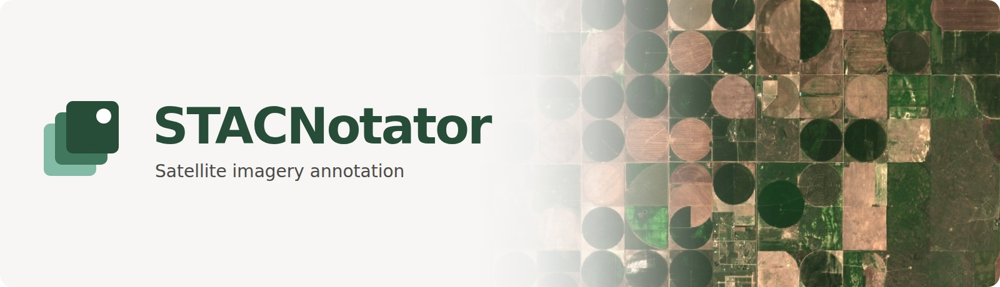

# STACNotator



[](https://github.com/RAAPID-ORG/stacnotator/actions/workflows/ci.yml?query=branch%3Adevelop)
[](LICENSE)
[](#project-maturity)
[](https://doi.org/10.5281/zenodo.23807896)

[Features](#features) | [Local development](#local-development) | [Deployment](#deployment) | [Documentation](#documentation) | [Contributing](#contributing) | [Citation](#citation)

## Project maturity

> [!IMPORTANT]
> STACNotator is under active development and is **alpha software**. Features,
> APIs, and configuration may change, and the documentation is still evolving.
> Evaluate it with your own imagery and workflows before relying on it, and
> back up your data before upgrading. Support for STAC catalogs other than
> Microsoft Planetary Computer is experimental.

## Overview

STACNotator is an open-source web application from [NASA Harvest](https://nasaharvest.org/)
for annotating satellite imagery time series. It connects to
[SpatioTemporal Asset Catalogs (STAC)](https://stacspec.org/), brings imagery from
different dates into a shared workspace, and lets people label locations or draw
features on a map.

It is intended for researchers and annotation teams building reference datasets
for remote sensing, including crop mapping, land-cover classification, and
model evaluation.

Imagery preloading and keyboard-driven navigation keep annotation fast and smooth
across dates and visualizations. It streams imagery from supported
catalogs and tile services, without requiring you to preprocess and maintain
your own imagery archive.

You can run it locally as a single user or host an instance for a team.
The [Python SDK](sdk/README.md) connects annotations to model-training and
active-learning workflows.

<sub>
<a href="docs/assets/README.md">Image credits and sources</a>.</sub>

## Features

| Feature                          | Description                                                                                                                                                          |
| -------------------------------- | -------------------------------------------------------------------------------------------------------------------------------------------------------------------- |
| Compare imagery over time        | Browse STAC collections and dated imagery slices, switch between custom visualizations such as true color and false color, and arrange synchronized imagery windows. |
| Label locations or draw features | Classify predefined points and polygons, or draw points, lines, and polygons while exploring. Add confidence scores, comments, and campaign-specific forms.          |
| Organize annotation work         | Group campaigns into projects and organizations, import or generate task locations, assign work, and track progress.                                                 |
| Review labels                    | Collect multiple answers per task, flag annotations for review, and configure whose answers count toward completion.                                                 |
| Bring your own layers            | Add Planet Basemaps, XYZ imagery, prediction rasters as COG overlays, and PMTiles vector layers. Some sources require credentials or a hosted tiler.                 |
| Use time series and embeddings   | Add Earth Engine time series and AlphaEarth embeddings when Earth Engine credentials are configured.                                                                 |
| Connect research workflows       | Export annotations as CSV or GeoJSON, use the Python SDK for active learning, or connect labelling agents through the MCP server.                                    |
| Share maps                       | Publish visualizers with imagery and overlays, optionally allowing access without an account. Check provider licenses before publishing.                             |

The interface supports English and Spanish, keyboard-driven annotation, and
saved workspace layouts, including pop-out windows for multiple monitors.
See the [full feature overview](docs/features.md) for details.

## Local development

The development stack runs the frontend, backend, and database in Docker, with
hot reloading. You need Git, [Docker Engine and Compose](https://docs.docker.com/compose/install/),
and Make. Allow at least 4 GB of RAM for the stack; imagery workloads may need more.

```bash
git clone https://github.com/RAAPID-ORG/stacnotator.git
cd stacnotator
cp .env.example .env

make dev-init
make dev-up
```

The default configuration uses a built-in local administrator, so you do not
need Firebase or Earth Engine to try the application. `make dev-init` builds
the images, starts the services, runs migrations, and seeds example campaigns.

| Service                       | Address                        |
| ----------------------------- | ------------------------------ |
| Application                   | http://localhost:5173          |
| Backend                       | http://localhost:8000          |
| Interactive API documentation | http://localhost:8000/api/docs |

> [!WARNING]
> Local authentication gives every request administrator access. Use it only on
> a trusted development machine, and do not expose the development ports to a
> network. Local authentication is refused in production.

Stop the stack with `make dev-down`. Data remains in Docker volumes.

### Optional imagery services

Microsoft Planetary Computer imagery with **first-valid compositing** works
without a hosted tiler. For other public STAC catalogs, advanced compositing or
masking, and custom COG overlays, enable the optional
[stacnotator-tiler](https://github.com/RAAPID-ORG/stacnotator-tiler) service by adding
these settings to `.env`:

```dotenv
COMPOSE_PROFILES=tiler
TILERS={"hosted":{"url":"http://localhost:8083","internal_url":"http://tiler:8000","allows_ingest":true}}
DEFAULT_TILER=hosted
```

Run `make dev-init` again to build and start the additional services.
Docker builds the tiler from its GitHub repository; no separate checkout is
needed. Use `TILER_CONTEXT` to select a local checkout instead, and see
[`.env.example`](.env.example) for port and COG-directory options. Without a
tiler, unsupported imagery configurations are rejected during campaign setup.

Earth Engine time series and embedding features require an
[Earth Engine service account](https://developers.google.com/earth-engine/guides/service_account).
Set `EE_SERVICE_ACCOUNT` and `EE_PRIVATE_KEY_PATH_HOST` in `.env` to enable them.
Leave those features off when working without Earth Engine credentials.

### Firebase authentication

Firebase is required for multi-user instances, including production deployments.
To use it in the development stack:

1. Create a project in the [Firebase Console](https://console.firebase.google.com/)
   and register a web app under **Project settings > General**. Copy its API key,
   auth domain, and project ID.
2. Under **Authentication > Sign-in method**, enable Email/Password, Google, or
   both. Add your application hostname to **Settings > Authorized domains**.
   Email/password users must verify their email before using STACNotator.
3. Under **Project settings > Service accounts**, generate a Firebase Admin SDK
   private key. Store the JSON file outside the repository.
4. In `.env`, set `AUTH_PROVIDER=firebase` and `VITE_AUTH_MODE=firebase`. Set
   `FIREBASE_CREDENTIALS_PATH_HOST` to the key file's path and fill in
   `VITE_FIREBASE_API_KEY`, `VITE_FIREBASE_AUTH_DOMAIN`, and `VITE_FIREBASE_PROJECT_ID`.
5. Create a user under **Authentication > Users**, copy its UID, and initialize
   the development stack for that account:

   ```bash
   make dev-init FIREBASE_UID="<YOUR-FIREBASE-UID>"
   make dev-up
   ```

The seed script makes that account a development administrator. For a production
instance, use the [first-administrator instructions](deployment/compose/README.md#set-up-the-first-administrator)
instead of seeding example data.

### Development commands

```bash
make dev-logs-backend   # Inspect backend logs
make dev-shell-backend  # Open a backend shell
make dev-migrate        # Apply database migrations
make dev-openapi        # Regenerate the frontend API client from the running backend
make dev-down           # Stop the development stack
```

To run tooling outside Docker, use Python 3.12 with [uv](https://docs.astral.sh/uv/)
for both the backend and SDK, and Node.js 22 with npm for the frontend.
The SDK also supports Python 3.10+ for users of the library.
Install the locked dependencies with `uv sync --frozen` in `backend/`
and `sdk/`, and `npm ci` in `frontend/`.

`make test` runs backend, SDK, and browser end-to-end tests; the latter need a
running frontend and Playwright's browser dependencies.
`make lint`, `make typecheck`, and `make format-check` run the individual quality
checks; `make ci-check` combines them with the tests. Install commit hooks with
`make pre-commit-install`. See the [development guide](docs/development.md)
and `make help` for the full workflow.

## Deployment

We provide [Azure deployment instructions](deployment/azure/README.md) for
Azure Container Apps, Static Web Apps, and PostgreSQL. Azure is the project's
primary deployment environment. The guide covers infrastructure prerequisites,
initial setup, secrets, domains, and releases through GitHub Actions or the
local deployment scripts.

The core application does **not** require Azure. You can run its containers
on another cloud, a virtual private server, or an on-premises Linux host.
The [Docker Compose deployment guide](deployment/compose/README.md) provides
a production environment template and an HTTPS gateway, including database
persistence, migrations, Firebase setup, and first-administrator provisioning.
This is a single-host starting point, not a high-availability setup.

Multi-user authentication still depends on Firebase. Earth Engine features,
paid imagery, and hosted tilers have their own service and credential
requirements. For a hosted tiler, the browser-facing app and tiler must share
a registrable domain, with matching token secrets and cookie configuration.
Azure managed-identity storage access does not carry over to another cloud.

Any public deployment needs HTTPS, unique secrets, backups, monitoring, and
operator-appropriate privacy and terms notices. Interactive API docs are
disabled in production. Read the deployment guide before exposing an instance.

## Documentation

| Guide                                                             | Contents                                                                                                       |
| ----------------------------------------------------------------- | -------------------------------------------------------------------------------------------------------------- |
| [Architecture](docs/architecture.md)                              | FastAPI backend, React/Vite/OpenLayers frontend, PostgreSQL with PostGIS and pgvector, and the optional tiler. |
| [Features](docs/features.md)                                      | Campaigns, imagery, annotation, review, and visualizers.                                                       |
| [Development](docs/development.md)                                | Repository workflow, code generation, checks, and CI.                                                          |
| [Tile serving](docs/tile-serving.md) and [tilers](docs/tilers.md) | Imagery providers, compositing, access control, and deployment topology.                                       |
| [Labelling policy](docs/labelling-policy.md)                      | Who can annotate, review, and contribute to task completion.                                                   |
| [Python SDK](sdk/README.md)                                       | Installation, annotation access, and active-learning examples.                                                 |
| [Agentic labelling](docs/agentic-labelling.md)                    | Agent setup and MCP integration.                                                                               |

Application code lives in `backend/` and `frontend/`, database image
configuration in `db/`, and the Python client in `sdk/`. Development and
production Compose files are at the repository root; hosting instructions
are under `deployment/`.

## Contributing

Bug reports, feature proposals, documentation improvements, and code
contributions are welcome. [Open an issue](https://github.com/RAAPID-ORG/stacnotator/issues)
to discuss a substantial change before implementing it, and read
[CONTRIBUTING.md](CONTRIBUTING.md) for the contribution process. Pull requests
target `develop`.

Report security problems privately using [SECURITY.md](SECURITY.md), not in
a public issue.

## License

STACNotator is released under the [MIT License](LICENSE). Imagery and other
data accessed through the application remain subject to their providers'
licenses and terms.

## Citation

If you use STACNotator in your research, please cite the software:

```bibtex
@software{stacnotator,
  author    = {Sawahn, Rohan and Humber, Michael and Sanchez Galvez, Antonio},
  title     = {{STACNotator}: A {STAC}-native platform for annotating satellite imagery time series},
  year      = {2026},
  publisher = {Zenodo},
  doi       = {10.5281/zenodo.23807896},
  url       = {https://doi.org/10.5281/zenodo.23807896}
}
```

This DOI represents all versions. For reproducibility, cite the specific version
you used via its version DOI on [Zenodo](https://doi.org/10.5281/zenodo.23807896).
Citation metadata is also available in [CITATION.cff](CITATION.cff).
