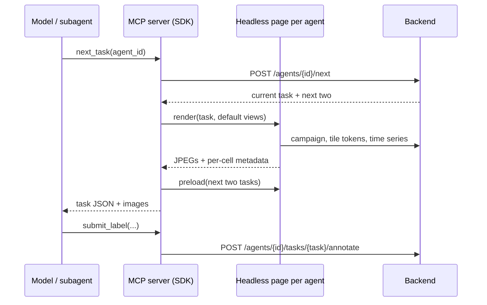

# Agentic labelling

A model can set up a new campaign and label the tasks of a campaign, alone or as a team of
subagents. It works through the `stacnotator` MCP server in the SDK: it looks at packed
images of the imagery around each task, asks for more detail when a point is unclear, and
submits labels like any other annotator.

## Setup

Install the plugin, which brings the labelling and campaign setup skills and the MCP server. You need
[uv](https://docs.astral.sh/uv/); there is nothing to clone or run yourself.

Claude Code:

```
/plugin marketplace add RAAPID-ORG/stacnotator
/plugin install stacnotator@stacnotator
```

Codex:

```bash
codex plugin marketplace add RAAPID-ORG/stacnotator
codex plugin add stacnotator@stacnotator
```

The agent always asks which STACNotator to use and needs its full URL. Then ask, e.g. "label 20 points of the Ukraine winter crop campaign on
https://your-stacnotator.example.org with 4 agents". The agent signs you in through a
browser tab the first time and asks once before downloading Chromium (about 150 MB), which
draws the images. The first start takes a minute while uv installs the SDK.

Other MCP clients: run
`uvx --from "stacnotator-sdk[agent] @ git+https://github.com/RAAPID-ORG/stacnotator#subdirectory=sdk" stacnotator-mcp`
over stdio and give the model
[`sdk/skills/stacnotator-labelling/SKILL.md`](../sdk/skills/stacnotator-labelling/SKILL.md)
and [`sdk/skills/stacnotator-campaign-setup/SKILL.md`](../sdk/skills/stacnotator-campaign-setup/SKILL.md).

On a bare Linux machine Chromium may also need system libraries:
`uvx playwright install-deps chromium` (needs sudo).

A campaign with point tasks needs a sample extent set: it is the red box drawn around each
point so the model knows what it is labelling.

## Setting up a campaign

Tools that create or change campaigns are off unless you grant them. The MCP server offers
only the ones named in `STACNOTATOR_MCP_ALLOW`, comma-separated, out of:

| tool | what it does |
| --- | --- |
| `create_campaign` | creates a campaign with its area, labels, guide, imagery and time series |
| `add_tasks` | adds tasks from GeoJSON, or random or grid sampling |
| `edit_campaign` | changes an existing campaign's settings, such as its name, guide, labels, area or form fields |
| `edit_imagery` | adds, replaces or removes an existing campaign's imagery sources and sets its basemaps |
| `edit_timeseries` | adds or removes time series (including custom indices) and renames their panels |

Set the variable before you start the client, for example
`STACNOTATOR_MCP_ALLOW=create_campaign,add_tasks claude`, or in Windows PowerShell
`$env:STACNOTATOR_MCP_ALLOW="create_campaign,add_tasks"; claude`. A model never sees a tool you did
not grant, and the server instructions tell it to report that instead of making the change
another way. This is a limit of the tool set, not a permission: the SDK login is your own
session, so a model with shell access could still call the API with it.

Ask in plain words, e.g. "set up a campaign to label maize vs other crops in Nakuru county,
Kenya". The skill does not fill in what you left open: it asks for the area (a box, which it
may propose for you to confirm), the years and season (proposing dates from the crop
calendar for you to confirm), the labels and how tasks are placed. It then puts the whole
proposal to you in the chat and, only once you accept it, creates the campaign, adds tasks
(your GeoJSON, or random or grid sampling across the box), waits until the imagery is
registered, draws the first tasks' views as a preview and gives you the link. Changing an
existing campaign works the same way, through `get_campaign` and then `edit_campaign`,
`edit_imagery` or `edit_timeseries`.

Time series accept `window_name` to group charts into panels. For a custom index, set
`ts_type` to its name and include `expression`, `domain_min` and `domain_max`.
`preview_custom_index(name, expression, domain_min, domain_max)` checks the formula and
returns the compatible sources without saving anything. `setup_options` lists each
source's available band roles.

`edit_timeseries(campaign_id, timeseries?, remove?, rename_windows?)` keeps existing charts
unless their ids are in `remove`. To change a formula, source or date range, add its
replacement and remove the old id; additions are saved first. The replacement has a new
id, so update agent views that name it. `get_campaign` returns series and panel ids,
expressions and chart domains. `rename_windows` takes `{"window_id", "name"}` entries and
preserves panel ids and layouts. These operations are not atomic: if one fails, inspect
`get_campaign` before retrying. Grant editing with `STACNOTATOR_MCP_ALLOW=edit_timeseries`.

Imagery is described by recipes over the Planetary Computer collections the campaign wizard
offers as presets. A recipe spells out each window, its slices and its cover as date ranges.
The headless page builds them with the wizard's own presets and collection builder
(`layers/imagery/recipe.ts`), so an agent-made source is searched and drawn like one made in
the wizard. `edit_imagery` merges recipes by source name: a recipe with a stored source's
name replaces its windows, visualizations and cloud cover, but the source keeps its id and
display settings, and windows and slices with unchanged dates keep theirs, so views, layouts
and registrations hold. A source made with the wizard's generator becomes plain windows when
replaced. Sources a recipe does not name stay as they are.

## Running a labelling run

Ask in plain words, e.g. "label 20 points of the Ukraine winter crop campaign with 4 agents".
The skill asks for whatever is missing (campaign, number of points, number of agents), then:

1. registers one agent per worker, with the points split evenly and take-over switched on,
2. launches one subagent per agent, each looping next task, extra views when needed, label or skip,
3. reports a table of task, label, confidence and evidence.

Registering also opens a window on your screen with each agent's latest views, which
explains what you are looking at and where to follow progress; closing it does not stop the
agents, and `watch_agents` reopens it. If you stop a run early, ask it to free the agents'
tasks, or use the Agents page.

### Recording a run

The MCP server saves a versioned JSONL log of returned task views, extra views,
time-series probes and submitted answers, independently of the watch window.
Each event includes its timestamp, agent and task, action, arguments, result,
returned images (base64 JPEGs), and any recorded error. Image metadata retains the
centres, zooms and pixel selections needed to reconstruct navigation later.
Submitted explanations are included; private model reasoning and conversation
outside tool calls are not captured. An image returned to a client is not proof
that its model processed it.

`register_agent` and `watch_agents` return the log path. Logs live in
`~/.config/stacnotator/recordings/` (or under `STACNOTATOR_CONFIG_DIR`), one file
per server session and deployment. The log is the output: visualization and replay
are separate consumers, not part of this implementation. A recording failure is
reported without retrying an already-saved annotation.

Files are readable only by their owner and contain no SDK credentials, but imagery,
locations and submitted explanations can be sensitive. Images can use substantial
disk space; delete unwanted recordings and share only with authorized people.

## Labelling through a model API

`stacnotator-label` does the same work without a coding agent: it calls a model API
directly, which is cheaper to run at scale and needs no Claude Code, Codex or Copilot
session. It uses the MCP server's tools in its own process, so views are drawn by the same
headless pages, and labels go through the same `submit_label` and `skip_task`.

```bash
uvx --from "stacnotator-sdk[api] @ git+https://github.com/RAAPID-ORG/stacnotator#subdirectory=sdk" \
  stacnotator-label run --url https://your-stacnotator.example.org --campaign 172 \
  --instructions rules.md \
  --base-url https://<resource>.openai.azure.com/openai/v1/ --model gpt-6-astra --entra \
  --agents 4 --tasks-per-agent 25 --reasoning medium \
  --log run.jsonl
```

- **The instructions file is the only source of labelling rules.** It holds the class
  definitions, decision rules and photo-interpretation hints the model must follow; the
  campaign's own guide is not sent. The model also gets how the tools and views work and the
  campaign's labels, form fields, imagery, basemaps and time series. Start from
  [`sdk/examples/labelling-instructions.md`](../sdk/examples/labelling-instructions.md).
- **One conversation per task.** Each task starts a new conversation with the task and its
  first look, so images never pile up across tasks. The model asks for more views and
  probes time series as often as it needs, within `--max-turns` replies, then calls
  `submit_label` or `skip_task`; on its last reply it can only call those two. When the
  backend rejects a label (an unknown label, a missing required form field), the error goes
  back to the model to correct.
- **First look.** `--first-look views.json` sets the 1-4 views every task opens with (the
  view syntax of `get_views`); without it, the built-in overview.
- **Missing tiles.** The render page waits up to 30 seconds for a view's tiles. When the
  first look still misses tiles, the model is told which cells, can ask for them again with
  `get_views`, and the label is flagged for review.
- **Content filters.** When the API refuses a turn's images (Azure does for some scenes),
  the turn is sent again without them and the label is flagged for review; when it refuses
  even that, the task is skipped with the reason.
- **Model API.** The runner uses the OpenAI Responses API: OpenAI,
  Azure OpenAI and Azure AI Foundry through their v1 endpoint, or any service that implements
  it. `--model` is the model or Azure deployment name. Authentication is the API key in
  `OPENAI_API_KEY` (or `--api-key-env`), or `--entra` for Microsoft Entra ID through
  `az login` (a role such as *Cognitive Services OpenAI User* or *Azure AI User* on the
  resource). When the resource is in another tenant than your default one, pass
  `--entra-tenant <tenant id>` (you must be able to sign in to it). A run starts with one
  tiny call to the model, so a wrong deployment name or sign-in stops it before any agent is
  registered.
- **Image limits.** Views are fitted to `--max-image-edge-px` and `--max-image-megapixels`
  (2048 px and 4 MP by default); set them to what your model takes in without downscaling.
- **Stopping and resuming.** Agents keep their unfinished tasks when a run stops. Resume with
  `run --agent-id <id>` (repeatable) or free them with
  `stacnotator-label release --url ... --campaign <id>`.

## How it works



- **Who can run agents.** Only project members. Campaign admins hand agents tasks from the
  open pool; other members only the tasks assigned to themselves, and freeing an agent's
  unfinished tasks gives them back to that member. At most 20 agents per person in a
  campaign.
- **Agents are annotators.** Registering creates a user owned by the signed-in account, adds
  it to the project and assigns it tasks with the normal assignment code. Labels, skips,
  statistics and review rows are ordinary annotations. `data.labelling_agents` only records
  the owner, campaign, description and the take-over setting.
- **Agents are not members.** They hold a project membership row so assignments work, but a
  run is temporary, so they are left out of the project members list, the users an admin can
  add, and the campaign's `users.csv`. Their work still shows up wherever annotations are
  attributed: statistics, the review page and the annotation exports.
- **Nothing is rendered on the server.** The MCP server opens `/agent-render?campaign=<id>`
  of the app in its own browser context per agent (so agents do not share tile connections)
  and calls `window.stacnotatorAgent` on it. The page draws with the same catalog, tile URLs,
  Planet scene search and time series code as the annotation page and returns the images.
  It signs in with the SDK login, which the MCP server hands to the page on request. For
  campaign setup it opens `/agent-render?project=<id>` instead, which exposes
  `window.stacnotatorSetup` to list the setup options, build a new campaign's imagery and
  merge recipes into an existing campaign's imagery.
- **Campaign context and default views come from the page**, built from the campaign it
  loaded: sources with collections and slices, basemaps, time series, labels, form fields
  and the guide.
- **Views.** A view is a grid of cells, each a slice (with a visualization), a basemap or a
  time series chart (optionally cloud-free and smoothed), at a zoom and cell size the model
  picks. Each cell carries a short readable label (`#3 May 2025, z17`); the metadata adds
  the exact dates, zoom, meters per pixel, the time series values and, for point tasks, the
  pixels inside the sample extent as numbers (mean colour, a green index, the share of
  bright and of missing pixels). Areas without tiles are hatched and flagged, and the red box
  is drawn outside the extent so nothing inside it is covered.
- **Image limits.** Models downscale large images before they see them, which silently
  loses detail. The model states the largest image it takes in unchanged when it registers
  an agent, and every view is fitted to that by shrinking its cells.
- **Step by step per point.** `next_task` returns a light first look (a few dates spread over
  the season at the dataset's configured zoom, the time series and a basemap pair).
  The agent submits immediately if that is enough. Otherwise it requests only evidence
  that could change the label, preferably relevant dates or a closer view of the same
  task, packed into one `get_views` call. Nearby comparisons are optional, not routine.
  When one would resolve a specific uncertainty, the agent picks a relevant patch in an
  existing image, or requests a wider view only if needed to find one, then sets
  `center: {reply, image, x, y}` and chooses an appropriate zoom.
  Every cell looks there unless it overrides `center`; the agent can inspect more dates,
  basemaps and charts there, pick again on the resulting images, or omit `center` to return
  to the assigned task. Coordinates are optional, not required. The red task marker stays
  at the original location, and task pixel statistics are omitted if its whole sample
  extent is outside the cell. Drawn views are cached by their full specification, including
  centre, so different locations do not reuse each other's images.
- **Probing.** `probe_timeseries` is the agent's timeseries tool: it clicks up to 6 places
  as pixels of an image it was shown (or as lat/lon), and gets the time series there
  charted beside the task's. Every reply with images is numbered, and a pixel names its
  reply and image. The MCP server keeps the views behind the agent's last 8 replies, at the
  size they were drawn and with the task they are centred on, and refuses a pick on any
  other reply or task rather than resolving it against the wrong image. The page finds the
  cell under each pixel and turns the pixel into a place with that cell's centre, zoom and
  OpenLayers' own resolution, the inverse of how the cell was drawn. The reply redraws the
  clicked cells with each point marked at the pixel it resolved to, so the agent can check
  its aim and click again.
- **Missing tiles.** A cell whose tiles were still loading when it was drawn carries
  `tiles_missing`, and the page does not keep that drawing, so asking for the same view again
  fetches them. Failed tiles only carry a `warning`: they are usually a date with no scene
  there, which drawing again never fills.
- **Imagery renewal.** MPC tile URLs expire. Before drawing, the page reads the campaign again
  once the backend says its mosaics are due for renewal, and waits while they register.
- **Preloading.** Every `next_task` draws the agent's default views for its next two tasks in
  the background, so a steady loop gets its images without waiting. Default views live in
  the MCP server's memory and reset when it restarts.
- **Take-over.** An agent with take-over on that runs out of tasks takes the last queued task
  of the owner's agent on the campaign with the most work left.

## Agents page

`/projects/<p>/campaigns/<c>/agents` lists your agents on a campaign with done and remaining
counts and when each last submitted a label, so a run that died is easy to spot. From there you can switch take-over per agent and free the unfinished tasks of one
agent or of all of them; labelled and skipped tasks stay. The page also explains the feature
and how to install the plugin, and the campaign overview links to it under the task sets.

## API

| route | |
| --- | --- |
| `POST /campaigns/{id}/agents` | register an agent and assign it `task_count` tasks |
| `GET /campaigns/{id}/agents` | total and open tasks, and your agents with their progress |
| `POST /campaigns/{id}/agents/release-tasks?agent_id=` | free unfinished tasks of one or all of your agents |
| `GET /agents/{agent_id}` | one agent |
| `PATCH /agents/{agent_id}` | switch take-over |
| `POST /agents/{agent_id}/next` | the current task and the next two, taking over work when empty |
| `POST /agents/{agent_id}/tasks/{task_id}/annotate` | label or skip |

## Limits

- Agents set up imagery only from the Planetary Computer presets. Other catalogs, Planet,
  custom maps and vector layers are added by a person in the app; `edit_imagery` keeps them
  as they are.
- Everything runs on the machine of whoever runs the MCP server: each agent's page is a
  Chromium renderer drawing several maps at once, so many parallel agents are bound by that
  machine's memory and CPU.
- Registrations go one at a time: task assignment locks the campaign's open pool, so two at
  once would leave the second agent without tasks.
